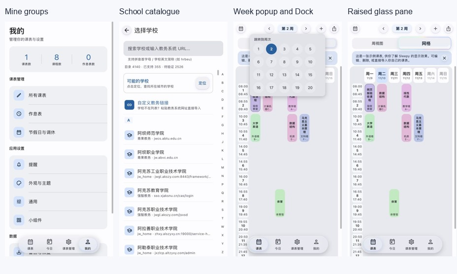
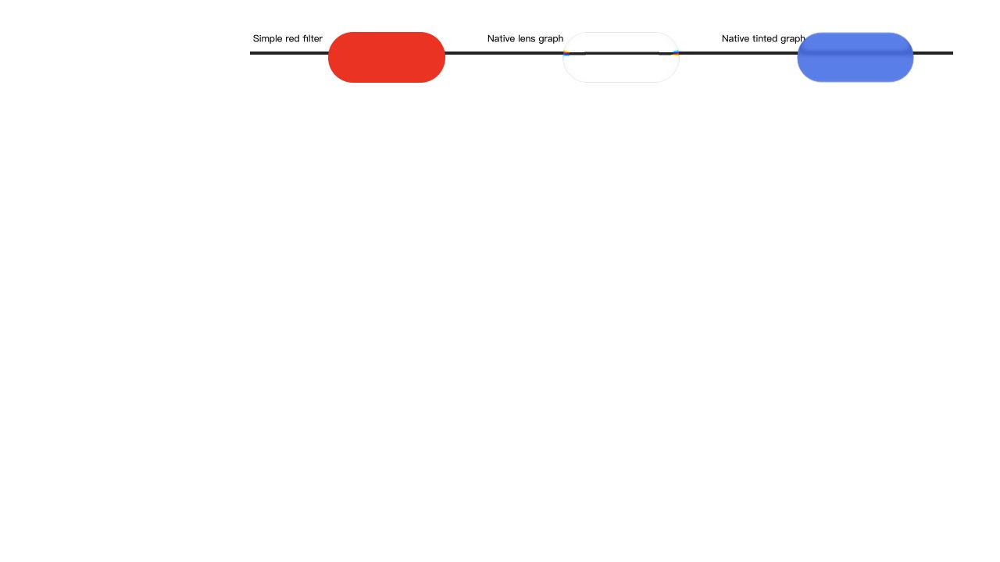
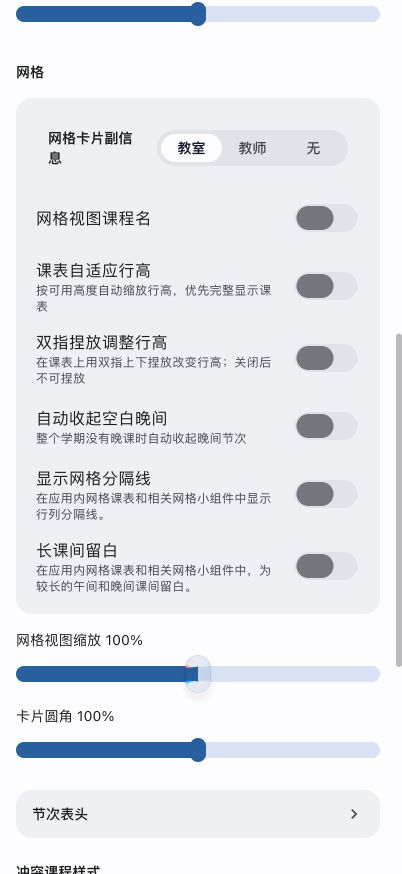
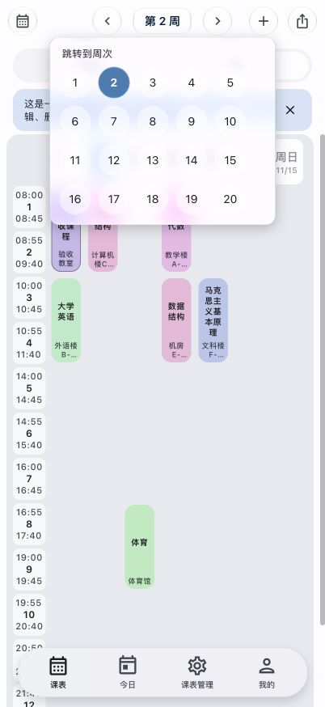

# Web 界面纠正验收，2026年11月10日

本记录以 Android v1.0.64 的 `77b878fd5c8903a3f201ea938b3b152de4c4fbc0` 为固定依据。先前 `b732010` 的玻璃使用边界和视觉验收已被用户拒收；原玻璃截图只保留为历史证据，不能证明本次实现。官网继续内嵌完整 `/preview/` 应用，并保留现有手机比例。

## 用户原话与实现行为

| 用户报告 | 实现及验收 |
| --- | --- |
| 教务导入页面和安卓不一样 | 搜索与计数在外层固定，推荐、自定义链接与学校分组共用滚动区，字母索引独立。保留4140所学校；185项协议显示名来自固定Android源码。实际用hrbeu查到目标，点选显示安卓版提示。详细尺寸见 [页面对账](android-screen-parity.md)。 |
| 我的页面整体布局不一样 | 恢复三个标题、四张设置卡、图标及缩进分隔线，统计和设置行保持原布局层级。已对照固定源码与设备应用设置段截图。 |
| 玻璃乱加、漏加，和原代码不同 | 取消按 HTML button、ARIA 与点击行为自动添加玻璃。依照固定原生源码逐处声明 regular、tinted、pill、menu、alert；普通设置卡、学校行和主题卡保持普通。完整范围见 [玻璃使用矩阵](glass-usage-parity.md)。 |
| 按住缺少折射、果冻、缓升缓落 | 采用来源可追溯的光学方程及独立位置、抬升、果冻弹簧。背景透镜和文字透镜分开；保留轨道6.5、内容3.6色散参数。分段42px轨道的稳定镜片为52px，上下各越出5px；开关、滑杆使用各自原生几何。 |
| 设置里面是裸按钮 | 补齐此前缺失的Material填色、tonal、描边、文字与图标按钮规则；经典模式实际截图中的重新配色按钮具有完整底色和48px高度。 |
| 脱壳交互不对 | 浮卡直接复用课程卡。静止显示原卡与两项操作；超过16px死区开始拖动并去掉模糊。实际拖动显示原周二1至2节到周三3至4节的确认，选择返回修改并Escape取消，原课未修改。 |
| 点周次后Dock消失 | 局部周次、切表、详情和分享弹层保留底栏；完整子页面仍按原导航合同隐藏。真实跳周截图可见Dock。 |
| 左侧节次占很大宽度挤压七天 | 时间栏最多与一个课程列等宽，文字优先收缩，受限时采用开始、节次、结束三行；不更改保存的显示偏好。真实四档测量见 [responsive.json](evidence/ui-correction-20261110/responsive.json)，详细来源与有意Web适配见 [列宽对账](grid-width-parity.md)。 |
| 周次必须严格居中，不换行 | 320、360、402、600视口的周次组中心分别为160、180、201、300，均与页面中心完全相同；完整“第2周”保留，七列表头顺序一致，无横向溢出。 |

## 布局不变量

```text
课表顶栏：侧控件       [左] [第 2 周] [右]       侧控件
                               居中于整个页面
课表网格：节次栏 | 周一 | 周二 | 周三 | 周四 | 周五 | 周六 | 周日
          左栏最多一列；每天标题与课程使用同一几何
我的页面：统计卡、课表管理卡、应用设置卡、数据卡、关于卡
选校页面：固定搜索和计数；推荐、链接、学校同区滚动；右侧字母索引
```

## 先前页面布局截图与当前玻璃证据



完整截图：

- [我的页](evidence/ui-correction-20261110/web-mine.png)
- [选校页](evidence/ui-correction-20261110/web-schools.png)
- [经典Material设置动作](evidence/ui-correction-20261110/web-material-settings.png)
- [课程长按](evidence/ui-correction-20261110/web-course-float.png)
- [跳周与Dock](evidence/ui-correction-20261110/web-week-dock.png)
- [被拒版本的按住玻璃，仅供历史对照](evidence/ui-correction-20261110/web-glass-held.png)
- [被拒版本的滑杆，仅供历史对照](evidence/ui-correction-20261110/web-slider-held.png)

截图使用最终功能源码的本地真实浏览器与已有示例数据，没有清空数据库或修改Android设备数据。设备同版本包曾被另一任务覆盖，因此源码事实源始终固定77b878fd；既有h15tvglc图片实际是所有课表页，没有当作选校页对照。

## 当前玻璃实现与验收

当前证据另存 `evidence/glass-correction-20261110/`。







[分段镜片](evidence/glass-correction-20261110/web-segment-rework-final-held.png)、[开关镜片](evidence/glass-correction-20261110/web-switch-rework-final-held.png)、[课程脱壳](evidence/glass-correction-20261110/web-course-float-rework-final.png)、[320宽度](evidence/glass-correction-20261110/web-320-rework-final.png)、[240宽度](evidence/glass-correction-20261110/web-240-rework-final.png)、[深色](evidence/glass-correction-20261110/web-dark-rework-final.png)。

- 白场、黑线、透明镜片对照：黑线经过 bevel 发生弯折和 RGB 分离，白色区域保持白色。
- 数据贴图改为不透明中性灰度标量，在 SVG 内重组位移通道，避免有色数据纹理经浏览器色彩转换后污染参数。
- 分段轨道为42高，镜片34升至52；独立文字采样保留放大。开关68乘48触摸槽、63乘28底轨、37乘24静置镜片，抬升稳定约63.6乘36。精细滑杆16乘24升至28乘40。
- 普通按钮按原生 ElasticPress 移动与回弹；只在原生调用处启用。静态菜单和警告载体不随内部按钮整体拖动。图标在48触摸槽内绘制36圆盘，并保持字形在玻璃之上。
- 真实浏览器拖动 Dock 时记录连续横向位置0.102、纵向偏移负1.42px和非零果冻伸缩；普通周次按钮同时出现横向、纵向偏移。松手后位移、抬升归零且缩放回到1。测量见 [拖拽记录](evidence/glass-correction-20261110/drag-measurements.json)。
- 240宽度的周次菜单保持左12、宽216、右228，不越出屏幕。见 [窄屏菜单](evidence/glass-correction-20261110/web-240-menu-final.png)。
- 固定底栏保持普通 Material，浮动 Dock 才启用 pill 底材。周次组、浮课按钮和快速加课维持自身定位，玻璃样式不改变 absolute 或 fixed。
- 禁用且未选中的有色动作按原生改用regular，重新启用恢复原色；选中项禁用时保留tint。两项回归先红后绿，实际课程表单空名称、填写、清空三态材质切换已核对，未保存草稿。
- 经典模式保留原有填色、描边、几何与按钮层级。备份页面的普通 Material 返回键明确排除玻璃。

## 验证范围

2026年11月10日最终冻结版本执行 `BASE_PATH=/ npm run build`，退出码为0；`npm test -- --maxWorkers=2 --minWorkers=1` 的152个文件、1556项测试全部通过，失败为0。构建资产为 `index--68mSLd5.js` 与 `index-D1zZHPqw.css`。`git diff --check` 通过。旧1486项结果仅对应被拒的上一版本，不作为此次完成依据。

周菜单窄屏回归先复现280px大于可用216px，再修正并通过。真实浏览器完成分段、开关、滑杆稳定悬起，Dock和普通按钮二维拖动、释放归零，320与240两档周次布局、周菜单保留Dock、浮课定位与明暗模式复核；本轮最后检查的运行时错误和警告均为空。静态光学图定义共享并精简数学等价分支，动态镜片保持独立，光学等价回归随全量通过。

Web采用SVG光学适配。空间Vogel模糊以Gaussian近似；没有声称实现基于实时背景亮度的五点自适应对比，也没有声称与Android RuntimeShader逐像素一致。菜单和警告使用原生角色的独立外圈。物理振动只保留浏览器能力调用，桌面没有验证手机触觉。没有创建Android Release或重复群公告。
